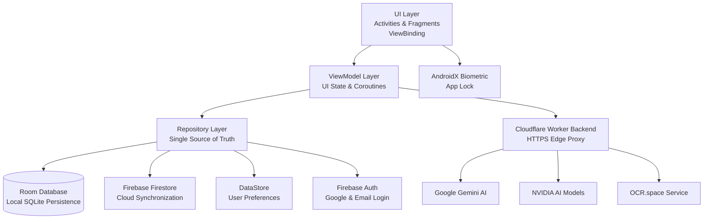

# Cognify

**AI-Powered Productivity and Knowledge Assistant**

[](https://play.google.com/store/apps/details?id=com.cognify.productivity)
[](https://www.android.com/)
[](https://kotlinlang.org/)
[](https://firebase.google.com/)
[](https://workers.cloudflare.com/)
[](https://ai.google.dev/)
[](LICENSE)

---

## Overview

**Cognify** is an all-in-one, offline-first personal productivity and knowledge management companion designed for Android.

Modern professionals, developers, and students frequently juggle multiple fragmented applications for tasks, notes, alarms, calculators, and AI assistance. Cognify eliminates this friction by unifying daily task planning, markdown-based knowledge capture, exact alarms, scheduling, mathematical calculation, and intelligent AI assistance into one cohesive, beautifully designed mobile application.

Built with an **offline-first philosophy**, Cognify guarantees that your data is always instantly accessible and editable on-device via Room database, synchronizing seamlessly with Google Firebase Firestore whenever an internet connection is available. Sensitive AI operations and document analyses are routed securely through a Cloudflare Worker edge proxy, safeguarding API keys and ensuring user privacy.

---

## Google Play Store

Cognify is officially published and available for download on the Google Play Store!

<a href="https://play.google.com/store/apps/details?id=com.cognify.productivity">
  
</a>

- **Status:** Officially Published
- **Package ID:** `com.cognify.productivity`
- **Listing URL:** [Download Cognify on Google Play](https://play.google.com/store/apps/details?id=com.cognify.productivity)

---

## Features

### 🤖 Gemini AI Assistant & Natural Language Actions
- **Context-Aware AI Chat:** Powered by Google Gemini through a secure backend proxy to assist with brainstorming, concept explanation, and study guidance.
- **Natural Language Command Execution:** Automatically parses user prompts into actionable application events (e.g., creating tasks or generating knowledge notes directly from chat).
- **Knowledge Vault Awareness:** Queries and references your saved notes and study materials to generate personalized answers.
- **Local Conversation History:** Securely saves chat threads with daily usage tracking.

### 📄 Document Intelligence & OCR
- **PDF & Document Processing:** In-app document extraction utilizing Apache PDFBox for Android.
- **Optical Character Recognition (OCR):** High-accuracy text extraction via OCR.space API.
- **AI Document Summarization:** Generates structured summaries, bullet points, and actionable takeaways from uploaded documents using NVIDIA AI and Gemini models.

### 📋 Offline-First Task Management
- **Full Task Lifecycle:** Create, edit, complete, and organize tasks.
- **Priorities & Categories:** Categorize tasks with visual priority badges (`High`, `Medium`, `Low`) and due dates.
- **Instant Search & Dynamic Filters:** Filter by completion status, priority, category, or search keywords in real time.
- **Two-Way Cloud Sync:** Room database acts as the single source of truth locally, with automated synchronization to Firebase Firestore.

### 🧠 Smart Knowledge Vault
- **Rich Markdown Notes:** Write, view, and format notes with full Markdown styling rendered via Markwon.
- **Code Snippet Management:** Syntax-formatted code storage with language tags (Kotlin, Java, Python, SQL, etc.).
- **Organization & Search:** Group notes with custom tags, categories, search filtering, and quick-access favorites.

### 📅 Calendar & Schedule Planning
- **Unified Timeline:** View tasks and scheduled commitments in a clean monthly and daily calendar layout.
- **Deadlines & Milestones:** Quickly identify overdue items and upcoming priorities at a glance.

### ⏰ Exact Alarms, Clock & Reminders
- **Background Reminders:** Reliable local task reminders powered by Android `WorkManager` and `AlarmManager`.
- **Full-Screen Alarm Experience:** Dedicated lock-screen alarm activity (`AlarmActivity`) with custom alarm tones, snooze, and dismiss controls.
- **Precision Stopwatch & Timers:** Built-in timer and lap-recording stopwatch for focused study or work sessions.

### 📊 Productivity Analytics & Streaks
- **Visual Dashboards:** Interactive charts powered by `MPAndroidChart` displaying task completion velocity and weekly/monthly trends.
- **Streak Tracking:** Gamified streak metrics to encourage daily consistency and habit building.

### 🧮 Integrated Productivity Calculator
- **Mathematical Expression Parser:** Built-in arithmetic and scientific computation powered by `exp4j`.
- **Persistent History:** Automatically stores calculation history for quick review and reference.

### 🔒 Biometric Security & Privacy Control
- **Biometric App Lock:** Fingerprint and face authentication via AndroidX Biometric API to secure private notes and data.
- **Account Deletion & Data Portability:** Export data anytime as formatted PDF or CSV files. Includes full GDPR and Google Play compliant self-service account and cloud data deletion.

### 🎨 Material Design 3 & Personalization
- **Modern Android Theming:** Supports Material You dynamic colors, responsive layouts, smooth Lottie animations, and edge-to-edge support.
- **Dark & Light Modes:** System-synchronized or manual theme switching.
- **Multilingual Support:** Localized resources including English and Tamil (`values-ta`).

---

## Screenshots

> Live screenshots can be viewed directly on the [Google Play Store listing](https://play.google.com/store/apps/details?id=com.cognify.productivity). Additional high-resolution promotional assets and screenshots can be placed in the `Screenshots/` directory.

| Dashboard & Overview | Task Management | Knowledge Vault | AI Assistant |
| :---: | :---: | :---: | :---: |
| *[ Dashboard Placeholder ]* | *[ Tasks Placeholder ]* | *[ Knowledge Vault Placeholder ]* | *[ AI Chat Placeholder ]* |

| Calendar & Schedule | Productivity Analytics | Exact Alarm & Clock | Security & Settings |
| :---: | :---: | :---: | :---: |
| *[ Calendar Placeholder ]* | *[ Analytics Placeholder ]* | *[ Clock Placeholder ]* | *[ Settings Placeholder ]* |

---

## Technology Stack

### Mobile Client (Android)
- **Language:** [Kotlin](https://kotlinlang.org/) (2.0.21)
- **Target SDK:** Android 36 (Android 14/15+) | **Min SDK:** Android 24 (Nougat 7.0+)
- **Architecture:** Android Jetpack (MVVM, Repository Pattern, ViewBinding, Navigation Component)
- **Dependency Injection:** [Dagger Hilt](https://dagger.dev/hilt/) with KSP
- **Local Persistence:** [Room Database](https://developer.android.com/training/data-storage/room) & [DataStore Preferences](https://developer.android.com/topic/libraries/architecture/datastore)
- **Concurrency:** Kotlin Coroutines & Asynchronous Flow
- **Background Tasks:** AndroidX WorkManager & AlarmManager
- **UI & Visualization:** Material Design 3, [MPAndroidChart](https://github.com/PhilJay/MPAndroidChart), [Markwon](https://github.com/noties/Markwon), [Lottie](https://airbnb.io/lottie/)
- **Document Processing:** [PDFBox Android](https://github.com/TomRoush/PdfBox-Android)
- **Math Evaluation:** [exp4j](https://www.objecthunter.net/exp4j/)
- **Networking:** Retrofit 2, OkHttp 3, Gson
- **Security:** AndroidX Biometric, Credential Manager, ProGuard / R8

### Cloud Backend & Services
- **Firebase Platform:**
  - **Firebase Authentication:** Secure email/password, anonymous session fallback, and Google Sign-In via Credential Manager.
  - **Cloud Firestore:** Real-time cloud synchronization and backup for tasks, notes, and reminders.
  - **Firebase Hosting:** Public compliance web pages for privacy policy and user account deletion.
- **Edge Backend (Cloudflare Workers):**
  - TypeScript runtime hosted on Cloudflare Workers (`backend.cognify-app-2026.workers.dev`).
  - Acts as a secure, rate-limited reverse proxy for AI APIs.
- **AI & ML Services:**
  - **Google Gemini API:** Conversational intelligence, natural language task parsing, and knowledge exploration.
  - **NVIDIA AI Foundation Models:** Multi-turn document analysis and summarization.
  - **OCR.space:** Cloud Optical Character Recognition for uploaded documents and images.

---

## Architecture

Cognify adheres to Google's recommended Modern Android Architecture standards, separating concerns across distinct layers:



1. **UI Layer:** Implemented using XML layouts, ViewBinding, and Material Design 3 components hosted in Fragments managed by the Jetpack Navigation Component.
2. **ViewModel Layer:** Manages observable UI state via Kotlin Flow and LiveData, executing asynchronous operations using structured Coroutine scopes.
3. **Repository Layer:** Serves as the single source of truth. Read operations query the local Room database, while background sync workers reconcile state with Firestore.
4. **Backend Edge Gateway:** AI requests route through Cloudflare Workers. This isolates API keys from the client APK, guarantees atomic usage accounting, and avoids direct exposure of cloud credentials.

For detailed system diagrams and schemas, refer to the [Documentation](Documentation/) directory:
- [Architecture Details](Documentation/architecture.md)
- [Database & ER Schemas](Documentation/database.md)
- [Application Workflows](Documentation/workflows.md)

---

## Project Structure

```
Cognify/
├── app/                                # Android application module
│   ├── src/main/
│   │   ├── java/com/cognify/
│   │   │   ├── ai/                     # AI parsing, command execution & Cloudflare client
│   │   │   ├── data/
│   │   │   │   ├── local/              # Room database, entities, and DAOs
│   │   │   │   ├── model/              # Domain models and enums
│   │   │   │   ├── remote/             # Remote API services (Gmail, Cloudflare)
│   │   │   │   └── repository/         # Repository implementations
│   │   │   ├── di/                     # Hilt dependency injection modules
│   │   │   ├── notification/           # Alarm, reminder receivers & foreground service
│   │   │   ├── ui/                     # Feature UI screens (Tasks, Vault, AI, Analytics, etc.)
│   │   │   └── util/                   # Biometrics, PDF/CSV exporters, network monitors
│   │   └── res/                        # Layouts, navigation graph, themes, audio & drawables
│   └── build.gradle.kts                # App dependencies, flavors, and build configs
├── backend/                            # Cloudflare Worker AI proxy backend (TypeScript)
│   ├── src/index.ts                    # Edge worker routing Gemini, NVIDIA & OCR
│   └── wrangler.jsonc                  # Cloudflare Wrangler configuration
├── functions/                          # Firebase Cloud Functions (Node.js/TypeScript)
├── public/                             # Public web assets (account deletion portal)
├── Documentation/                      # Architectural diagrams, database & workflow docs
├── Screenshots/                        # Application preview images and screenshots
├── APK/                                # Pre-built release APK packages
├── AAB/                                # Android App Bundle builds for Play Store
└── build.gradle.kts                    # Root build configuration script
```

---

## Installation and Setup

### Prerequisites
- **Android Studio:** Ladybug (2024.2.1+) or newer recommended.
- **JDK:** Version 11 or 17 (configured via Gradle JVM toolchain).
- **Android SDK:** Compile SDK 36, Min SDK 24.
- **Git**

### Local Development Setup

1. **Clone the Repository:**
   ```bash
   git clone https://github.com/your-username/Cognify.git
   cd Cognify
   ```

2. **Configure Firebase:**
   - Create a project in the [Firebase Console](https://console.firebase.google.com/).
   - Add an Android App with the package name:
     - `com.cognify` (Base)
     - `com.cognify.productivity` (Production Flavor)
     - `com.cognify.demo` (Demo Flavor)
   - Enable **Firebase Authentication** (Email/Password, Anonymous, Google).
   - Enable **Cloud Firestore** and deploy the rules in `firestore.rules`.
   - Download `google-services.json` and place it in the `app/` directory:
     ```
     Cognify/app/google-services.json
     ```

3. **Configure Local Properties:**
   - Create or update `local.properties` in the project root:
     ```properties
     sdk.dir=YOUR_ANDROID_SDK_PATH
     GEMINI_API_KEY=YOUR_OPTIONAL_GEMINI_API_KEY
     ```

4. **Build and Run:**
   - Open the project in Android Studio.
   - Sync Gradle files.
   - Select the desired build variant (e.g., `productionDebug` or `demoDebug`).
   - Run the application on an emulator or connected physical device.

---

## Environment Variables and Configuration

Cognify is configured with strict secret isolation:

| Configuration Item | Location | Purpose | Committed to Git? |
| :--- | :--- | :--- | :--- |
| `google-services.json` | `app/` | Firebase configuration for client SDKs | ❌ No (Keep Private) |
| `local.properties` | Root | Android SDK path & local development API keys | ❌ No (Ignored) |
| `keystore.properties` | Root | Release signing keystore passwords & aliases | ❌ No (Ignored) |
| `CLOUDFLARE_AI_BACKEND_URL` | `app/build.gradle.kts` | Cloudflare Worker endpoint URL | Configured in build |
| Cloudflare Worker Secrets | Cloudflare Dashboard / Wrangler | `GEMINI_API_KEY`, `OCR_SPACE_API_KEY`, `NVIDIA_*_KEY` | ❌ Encrypted at Edge |

> **Note:** Never commit `keystore.properties`, keystore files, or production API keys to public source control.

---

## Security

- **Server-Side API Key Protection:** Client builds do not bundle third-party AI secret keys. All Gemini, NVIDIA, and OCR requests pass through the Cloudflare Worker proxy where authentication secrets are securely held as encrypted environment variables.
- **Biometric Protection:** Users can enable biometric authentication to require fingerprint or face unlock before accessing private notes, tasks, or settings.
- **R8 / ProGuard Obfuscation:** Production release builds enable code shrinking, resource shrinking, and identifier obfuscation via `proguard-rules.pro`.
- **Granular Cloud Firestore Rules:** Firestore security rules enforce strict user-isolation. Authenticated users can only read, write, or delete documents within their own `/users/{uid}` path.
- **Play Store & GDPR Compliance:** Provides transparent privacy disclosure, in-app policy viewing, and a dedicated public web endpoint for account and cloud data deletion.

---

## Contributing

Contributions to Cognify are welcome! To contribute:

1. Fork the repository.
2. Create a feature branch:
   ```bash
   git checkout -b feature/YourFeatureName
   ```
3. Commit your changes with descriptive messages:
   ```bash
   git commit -m "Add YourFeatureName"
   ```
4. Push to your branch:
   ```bash
   git push origin feature/YourFeatureName
   ```
5. Open a Pull Request detailing your changes and testing procedures.

---

## License

This project is licensed under the **MIT License**. See the [LICENSE](LICENSE) file for complete license terms.

---

## Contact

- **Developer / Project Support:** [krctstu@gmail.com](mailto:krctstu@gmail.com)
- **Account & Data Management:** [Account Deletion Portal](https://cognify-8ac56.web.app/delete-account.html)
- **Google Play Listing:** [Cognify on Google Play](https://play.google.com/store/apps/details?id=com.cognify.productivity)
