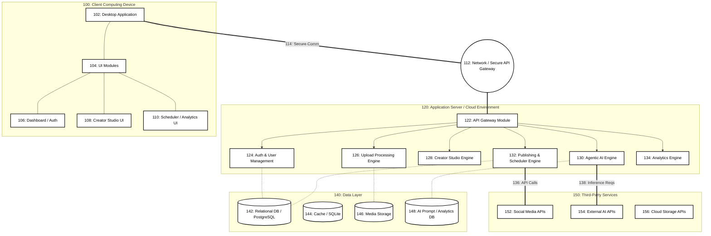
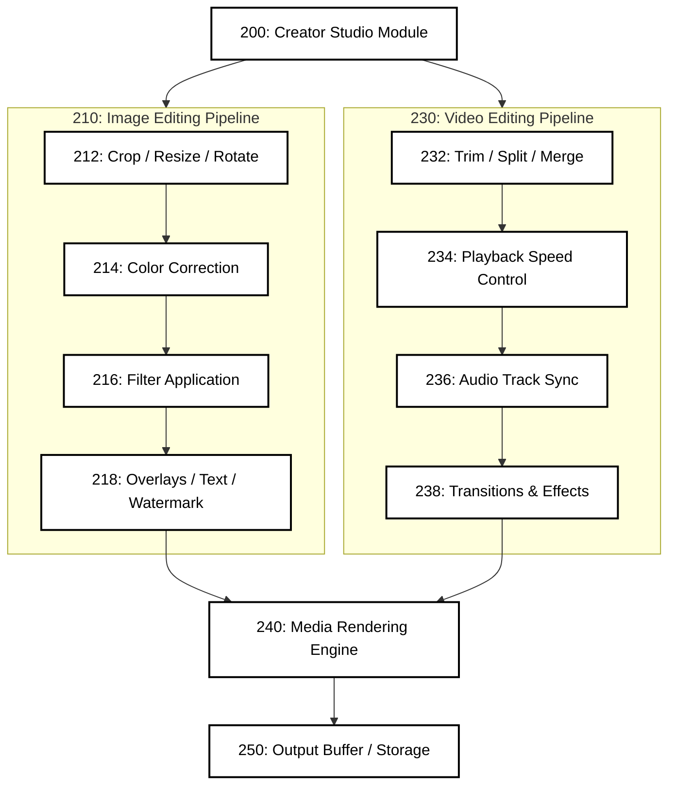
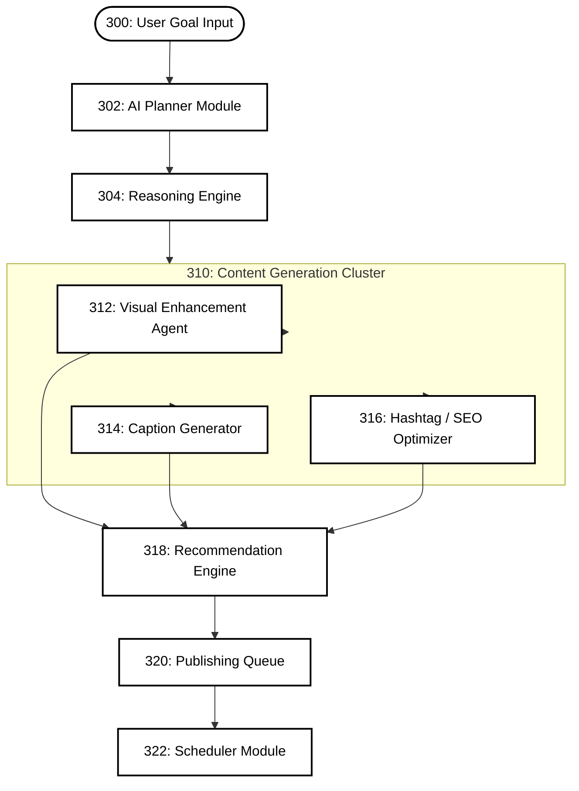
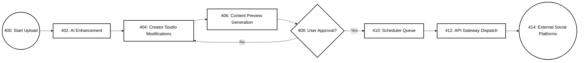
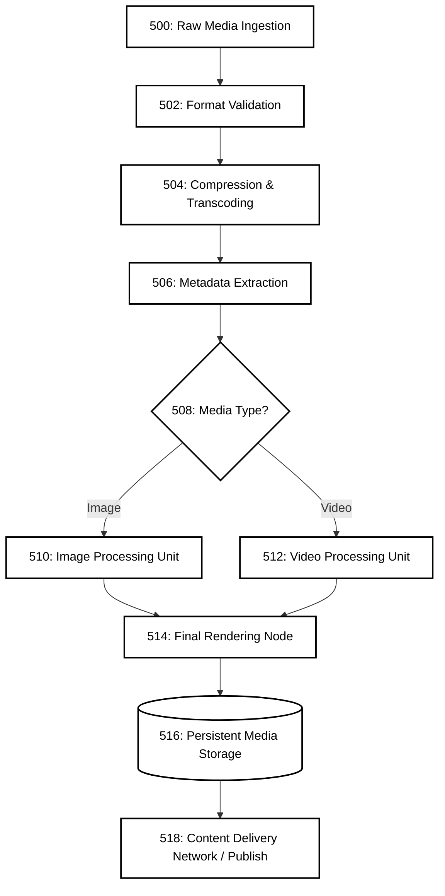
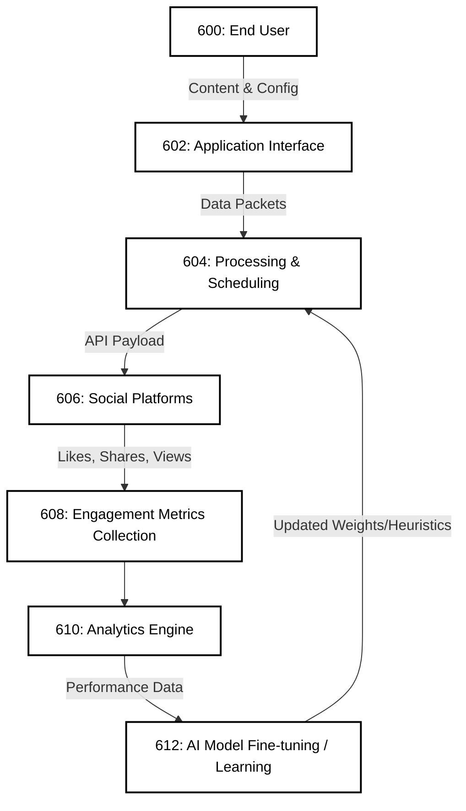
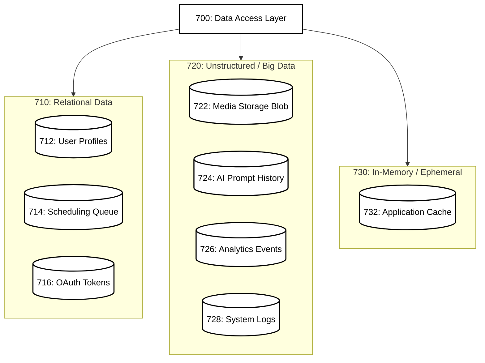
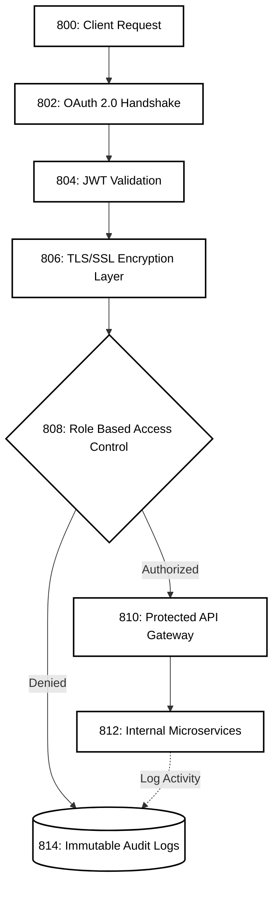

# Patent Architecture Diagrams

This document contains the 8 requested patent-style architecture diagrams for **CreatorOS** (or your final project name). They are designed with strict patent conventions:
- **Black-and-white, high-contrast styling** (no gradients or colors, as patent offices require B&W line drawings).
- **Numbered components** (100, 102, 104, etc.) consistent with WIPO and USPTO standards.
- **Hierarchical structure and clear data flow**.

## How to use these in diagrams.net (draw.io), Visio, or Figma

These diagrams are generated using **Mermaid**, a standard text-to-diagram syntax. To convert these into fully editable vector diagrams:
1. Open **diagrams.net (draw.io)**.
2. Go to **Arrange > Insert > Advanced > Mermaid...**
3. Copy the code block for a figure below (starting from `graph TD` or `flowchart TD`) and paste it into the box.
4. Click **Insert**. The diagram will be rendered as editable shapes and text!
5. You can now tweak lines, reposition boxes, and export as **SVG, PDF, or VSDX (Visio)** for your patent attorney.

---

### FIG. 1 — Overall System Architecture

This figure shows the high-level components of the entire platform.

---

### FIG. 2 — Creator Studio Internal Architecture

This figure breaks down the media processing capabilities.

---

### FIG. 3 — Agentic AI Architecture

This figure demonstrates the AI decision-making loop.

---

### FIG. 4 — Publishing Workflow

This figure shows the step-by-step state machine of the publishing process.

---

### FIG. 5 — Media Processing Pipeline

A specialized view of how raw data is ingested and converted into published media.

---

### FIG. 6 — Data Flow Diagram (Feedback Loop)

Shows how user engagement data feeds back into the AI engine.

---

### FIG. 7 — Database Architecture

Highlights the distinct data domains and storage technologies.

---

### FIG. 8 — Security Architecture

Details the authentication and authorization path.

